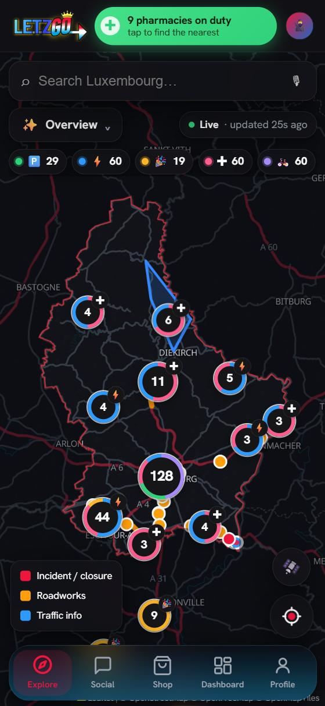
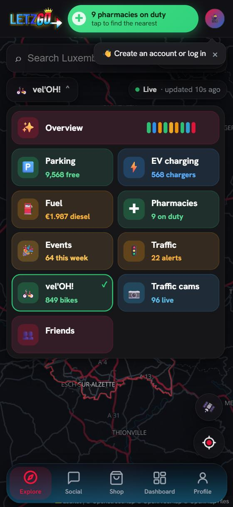
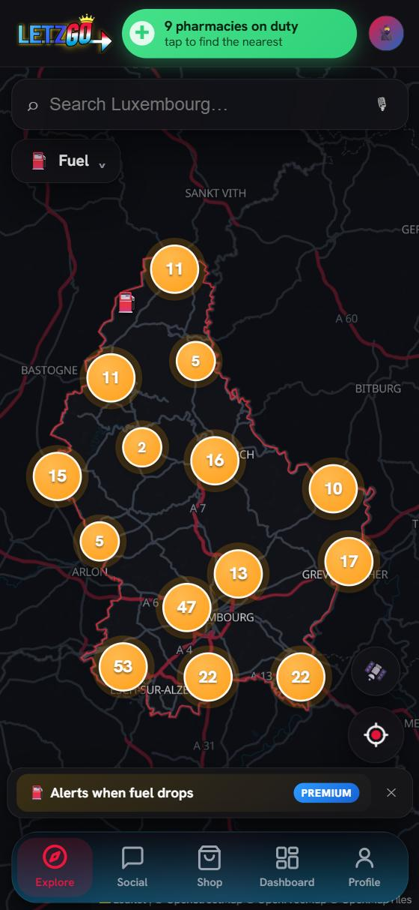

# LetzGo — Luxembourg Utility PWA

**Real-time hyper-local information for Luxembourg residents and cross-border commuters.**

[🌐 Open LetzGo](https://letz-go.vercel.app)

  
  
  

## What is LetzGo?

LetzGo is a fast, beautiful, and **offline-first Progressive Web App** that brings together everything you need for daily life in Luxembourg:

- **Live Parking** — Availability, history, photos and payment options
- **EV Charging** — Chargy network status, tariffs and live availability
- **Fuel Prices** — Real-time prices across stations
- **On-duty Pharmacies & Services**
- **Friends & Social** — Location sharing and in-app calls
- **Push Notifications** — Stay updated even when the app is closed

Built from the ground up as a true PWA — installable on iOS and Android with native-like experience (splash screens, shortcuts, offline support).

LetzGo runs in two modes, **LU** and **PT**, each with its own data sources and rules.

## Why LetzGo?

Luxembourg is small but mobility needs are high. LetzGo combines multiple scattered services into one clean, reliable tool that works even with poor connectivity.

## Features

- Fully offline-capable (Service Workers + cached data)
- Native app-like feel on mobile and desktop
- Fast loading and smooth Leaflet map experience
- Automated data updates via Python pipelines
- Privacy-focused & lightweight

## Data and caching design

LetzGo runs in two separate modes, **LU** and **PT**. Each has its own data sources and refresh rules, and nothing is combined across countries.

### Data paths

| Data | Source | Path to the device | Stored in our DB? |
|---|---|---|---|
| Parking availability (LU) | Luxembourg public API | Each device fetches it directly, every minute. It's a tiny JSON, so load is negligible | No |
| Parking images (LU) | Luxembourg public API | Cached by our server with a checksum. Devices ask the server for the checksum first and download the image only if it changed | Yes |
| Fuel prices (PT) | DGEG, under an official access agreement | Our server fetches and holds the data. Devices read from our server, never from DGEG | Yes |
| Fuel prices (LU) | carbu.com's national maximum-price page (Diesel, Euro 95, Euro 98, LPG), scraped once a day. Station locations come from OpenStreetMap | A nightly GitHub Action refreshes the data and saves it as static files in `web/data/fuel/` | No, static files |

**Why Luxembourg fuel uses a daily scrape:** the government sets a daily maximum price, and at almost every station the price is that maximum. It doesn't publish it through a public API, so LetzGo reads the national maximum-price page on carbu.com once a day.

**Why PT fuel goes through our server:** about 5,000 stations, several prices per station and a lot of per-station data. Having every user pull that from DGEG would be heavy for them and fragile for us. One server fetch protects the provider and keeps the app fast.

**Why parking goes direct:** the payload is small enough that every user fetching it each minute is fine.

### Image caching with checksums

1. The server computes a checksum when it caches an image.
2. The device asks only for the checksum.
3. If it matches the checksum stored in the device's localStorage, the image hasn't changed and nothing is downloaded.
4. If it differs, the device downloads the new image and updates its local copy.

### Refresh rules

- Each data set refreshes **independently**, not in one pass.
- Parking: refresh on the next minute rollover after the app is online.
- Fuel prices (PT): refresh on the next full hour.
- Fuel prices (LU): refresh once a day at 00:04, because Luxembourg's government mandates a daily maximum price.
- If the daily LU scrape fails, the app shows the last price that worked, or backup values from a config file.
- *(Planned)* A failed fuel request at launch sets a **needs-refresh** flag; the app refreshes fuel prices as soon as the network returns.

### Offline behaviour

- First launch ever, no signal: a loading state, since nothing is cached yet.
- Returning users: all data comes from localStorage, with parking and fuel data **timestamped in the UI** so users see how old it is.
- The map doesn't change, so it renders as usual.

### Known limitation

Luxembourg fuel prices depend on scraping carbu.com, because the government exposes no public API. If carbu.com changes its page, the scrape can fail and prices quietly stop updating. The app then falls back to the last good price (or the config backup), and the timestamp in the UI shows how old it is.

## Tech Stack

- **Frontend**: Vanilla JavaScript, Leaflet, PWA (Manifest + Service Worker)
- **Data**: Python scrapers + GitHub Actions → static JSON
- **Hosting**: Vercel
- **Extras**: Push notifications, WebRTC, Stripe-ready

## Links

- **Live App**: [letz-go.vercel.app](https://letz-go.vercel.app)
- Founder: [Bruno Araújo](https://github.com/BrunoAraujo99)

---

⭐ Star this repo if you're in Luxembourg or find it useful!

Built with ❤️ in Luxembourg.
